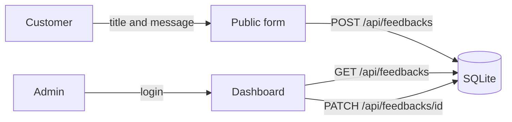
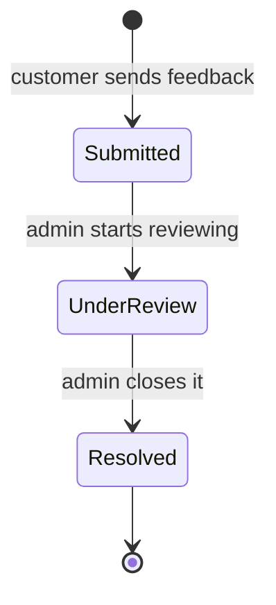

<div align="center">


<p>
  
  
  
  
  
  
</p>

**A lightweight feedback management system.**
Customers submit feedback through a polished glassmorphism form. Admins review everything from a protected dashboard and move each item through a clear status workflow.

</div>

---

## Table of contents

- [Features](#-features)
- [Screenshots](#-screenshots)
- [How it works](#-how-it-works)
- [Tech stack](#-tech-stack)
- [Getting started](#-getting-started)
- [Usage](#-usage)
- [API](#-api)
- [Project structure](#-project-structure)
- [Configuration](#-configuration)
- [Contributing](#-contributing)
- [Author](#-author)

---

## ✨ Features

| | Feature | Description |
|---|---|---|
| 📝 | **Public feedback form** | Customers submit a title and a message through a smooth, RTL-friendly interface. |
| 🔐 | **Admin dashboard** | A protected login page lets admins view every submitted feedback. |
| 🚦 | **Status tracking** | A three-stage workflow: `ثبت شده` → `در حال بررسی` → `رسیدگی شده` (Submitted → Under review → Resolved). |
| 🔌 | **REST API** | Clean FastAPI endpoints to create, list and update feedback. Swagger docs included. |
| 🎨 | **Glassmorphism UI** | Dark theme, animated interface, Vazirmatn font and a full RTL layout. |
| 🍪 | **Session-based auth** | Simple admin authentication using Starlette sessions. |
| 🗄️ | **Zero-config database** | SQLite through the SQLAlchemy ORM. Nothing to install or configure. |

## 🖼️ Screenshots

> Add your own screenshots to `docs/` and they will show up here.

<div align="center">

| Public form | Admin login | Dashboard |
|:---:|:---:|:---:|
|  |  |  |

</div>

## 🧭 How it works



Every feedback moves through three statuses:



*(Submitted = `ثبت شده`, Under review = `در حال بررسی`, Resolved = `رسیدگی شده`)*

## 🛠️ Tech stack

| Layer | Technology |
|---|---|
| Backend | [FastAPI](https://fastapi.tiangolo.com/) |
| ORM | SQLAlchemy |
| Database | SQLite |
| Validation | Pydantic v2 |
| Templates | Jinja2 |
| Frontend | Vanilla HTML / CSS / JS (RTL, Vazirmatn font) |
| Auth | Starlette `SessionMiddleware` |

## 🚀 Getting started

**Prerequisites:** Python 3.10+

```bash
# 1. Clone the repository
git clone https://github.com/SepidehPashayan/Feedback_board.git
cd Feedback_board

# 2. Create and activate a virtual environment
python -m venv venv
source venv/bin/activate      # On Windows: venv\Scripts\activate

# 3. Install dependencies
pip install -r requirements.txt

# 4. Run the application
uvicorn main:app --reload
```

The app is now available at **http://127.0.0.1:8000**.

## 📖 Usage

**Submitting feedback (public)**
Open `http://localhost:8000/`, fill in a title and a message, and submit.

**Admin dashboard**
1. Go to `http://localhost:8000/login`
2. Enter your admin credentials
3. View all feedback and update their statuses

> ⚠️ **Before deploying**, change the admin credentials and the `secret_key` in `main.py`.

## 🔌 API

| Method | Endpoint | Description |
|---|---|---|
| `GET` | `/api/feedbacks` | List all feedback entries |
| `POST` | `/api/feedbacks` | Submit new feedback |
| `PATCH` | `/api/feedbacks/{feedback_id}` | Update the status of a feedback |

Interactive docs (Swagger UI) are available at `http://localhost:8000/docs`.

**Submit feedback**

```bash
curl -X POST "http://localhost:8000/api/feedbacks" \
  -H "Content-Type: application/json" \
  -d '{"title": "Delivery Issue", "message": "My order arrived late."}'
```

**Update a status**

```bash
curl -X PATCH "http://localhost:8000/api/feedbacks/1" \
  -H "Content-Type: application/json" \
  -d '{"status": "در حال بررسی"}'
```

## 📁 Project structure

```text
Feedback_board/
├── main.py              # FastAPI app, routes and auth logic
├── models.py            # SQLAlchemy database models
├── schemas.py           # Pydantic request/response schemas
├── database.py          # Database engine and session setup
├── requirements.txt     # Python dependencies
├── feedback.db          # SQLite database (auto-created on first run)
├── static/
│   └── images/
│       └── background.png
├── templates/
│   ├── index.html       # Public feedback submission page
│   ├── login.html       # Admin login page
│   └── dashboard.html   # Admin feedback management dashboard
└── docs/                # Screenshots used in this README
```

## ⚙️ Configuration

Before going to production, update these values in `main.py`:

```python
# Change these!
ADMIN_USERNAME = "your_admin_username"
ADMIN_PASSWORD = "your_secure_password"
app.add_middleware(SessionMiddleware, secret_key="a-long-random-secret")
```

For production, consider moving from SQLite to PostgreSQL or MySQL by changing `SQLALCHEMY_DATABASE_URL` in `database.py`.

## 🤝 Contributing

Pull requests are welcome. For major changes, please open an issue first to discuss what you would like to change.

## 👩‍💻 Author

**Sepideh Pashayan**

[](https://github.com/SepidehPashayan)

---

<div align="center">

If this project was useful, consider giving it a ⭐


</div>
